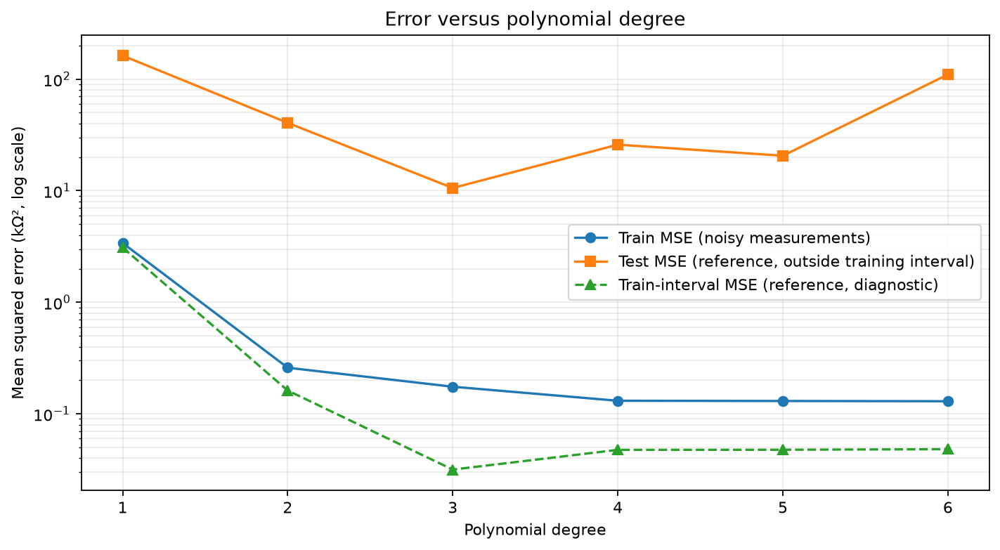
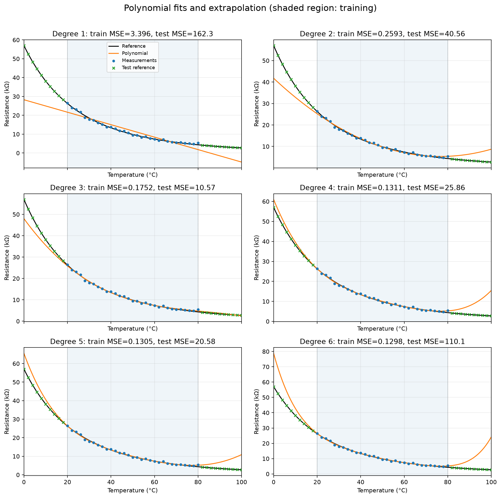
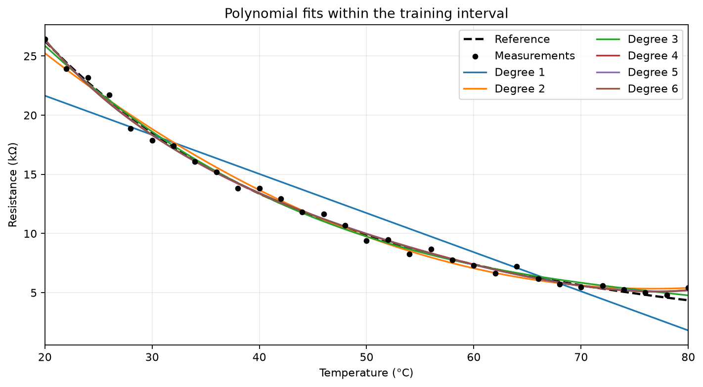
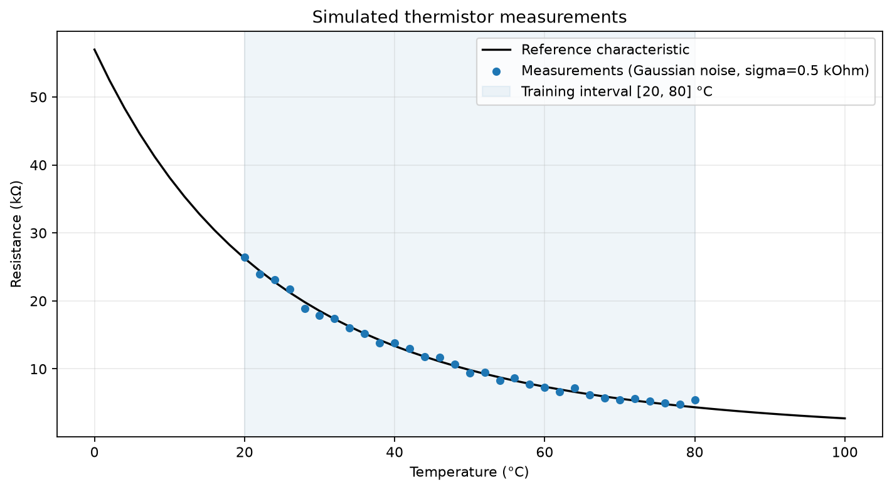

# 热敏电阻多项式拟合与误差分析

## 运行方法与文件

在项目根目录执行 `python3 assign2/thermistor_polynomial_fit.py`。依赖 `numpy` 和 `matplotlib`。
脚本从自身位置定位输入和输出，亦可在其他目录运行。所有输出保存在 `assign2/`。

- `simulated_data.csv`：31 个训练点的参考阻值、噪声和模拟测量值。
- `model_coefficients.csv`：各模型系数，列按 a6 至 a0 排列，超出模型阶次的项填零。
- `model_errors.csv`：六种模型的 MSE，单位均为 kΩ²。
- `model_predictions.csv`：51 个原始温度点的预测结果；is_train=1 表示训练点。
- `simulated_measurements.png/svg`：模拟测量数据。
- `polynomial_fits.png/svg`：六种模型在 0～100°C 上的曲线。
- `training_fits.png/svg`：训练范围内的拟合细节。
- `mse_vs_degree.png/svg`：误差随阶次变化，纵轴采用对数刻度。

## 数据与方法

本实验读取第 1 项的 `assign1/thermistor_data.csv`，其阻值保留六位小数。
参考数据来自 R(t)=22 exp[3100(1/(t+273.15)−1/298.15)] kΩ，但拟合过程只使用温度和模拟测量值，不使用该公式。

训练温度为 20, 22, …, 80°C，共 31 个点；测试温度为 0, 2, …, 18°C 和 82, 84, …, 100°C，共 20 个点。
训练、测试集无重叠，合起来覆盖原始 51 个点。20°C 和 80°C 均属于训练集。

对训练阻值加上独立高斯噪声 ε ~ N(0, 0.5²)，单位为 kΩ，即标准差 500Ω。
使用 NumPy `default_rng(42)`，且六种模型使用同一组测量数据。
本次噪声的样本均值为 0.042679 kΩ，样本标准差（ddof=1）为 0.426870 kΩ。
零均值和 0.5 kΩ 指生成分布的参数；有限样本的统计量无需恰好等于它们，也未对噪声重新中心化。

使用 `numpy.polyfit`（对应 MATLAB 的 `polyfit`）分别求解 1～6 阶多项式的最小二乘问题：

\[
\min_{a_0,\ldots,a_n}\sum_{i=1}^{31}[\hat R_n(t_i)-R_i^{\mathrm{measured}}]^2,
\qquad \hat R_n(t)=a_nt^n+\cdots+a_1t+a_0.
\]

这里 t 使用 °C，阻值使用 kΩ；a_j 的单位为 kΩ/(°C)^j。
所有 MSE 在 2°C 的原始采样点上计算，图中加密绘制的曲线点不参与误差计算。

## 六种多项式模型

下列系数展示 12 位有效数字；CSV 保留浮点输出精度，预测和误差计算使用未格式化的系数。

- **1 阶**：\(\hat R_1(t)=-0.33063174236t + 28.2609843958\)

- **2 阶**：\(\hat R_2(t)=0.00619782950522t^2 - 0.950414692881t + 41.7722527172\)

- **3 阶**：\(\hat R_3(t)=-6.48463318355\times 10^{-5}t^3 + 0.0159247792805t^2 - 1.39946257158t + 48.013063693\)

- **4 阶**：\(\hat R_4(t)=3.03098348711\times 10^{-6}t^4 - 0.000671043029257t^3 + 0.0589041251278t^2 - 2.66641366919t + 60.9806294613\)

- **5 阶**：\(\hat R_5(t)=-2.38613082471\times 10^{-8}t^5 + 8.99631054889\times 10^{-6}t^4 - 0.00124228274869t^3 + 0.0849368124254t^2 - 3.22754535667t + 65.533825212\)

- **6 阶**：\(\hat R_6(t)=1.5545519521\times 10^{-9}t^6 - 4.90226893878\times 10^{-7}t^5 + 6.52767441312\times 10^{-5}t^4 - 0.00472560970464t^3 + 0.201084769214t^2 - 5.19846601634t + 78.7937133404\)

## 误差结果

MSE = (1/N) Σ(预测阻值 − 对照阻值)²，单位为 kΩ²。
训练 MSE 对照带噪测量值，测试 MSE 对照未加噪声的参考值。
另列训练范围内对照参考值的误差作为诊断，不参与拟合。

| 阶次 | 训练 MSE（带噪） | 测试 MSE（参考值） | 训练范围 MSE（参考值，辅助） |
|---:|---:|---:|---:|
| 1 | 3.39622934 | 162.33107268 | 3.09477397 |
| 2 | 0.25926272 | 40.55891340 | 0.16197997 |
| 3 | 0.17519817 | 10.57285888 | 0.03168152 |
| 4 | 0.13112031 | 25.85813004 | 0.04761894 |
| 5 | 0.13047462 | 20.57928482 | 0.04772011 |
| 6 | 0.12983643 | 110.09045445 | 0.04827983 |

## 结果讨论

训练 MSE 随阶次增加而不升高，因为高阶多项式包含低阶模型的全部候选解。
这一性质只针对同一组数据上的未正则化最小二乘残差，不能保证对真实曲线的预测更好。
1 阶模型无法充分描述阻值随温度变化的弯曲形状，训练误差较大，体现欠拟合。
加入二次和三次项后，训练误差明显下降；更高阶模型继续降低残差，也可能把部分测量噪声纳入曲线。

本次实验中，测试 MSE 最小的是 **3 阶**，值为 **10.57285888 kΩ²**。
测试误差从 1 阶到 3 阶连续下降，4 阶回升至 25.85813004，
5 阶降至 20.57928482，6 阶又显著增大至 110.09045445 kΩ²，呈非单调变化。
与此同时，4～6 阶的训练 MSE 仅有小幅改善，训练范围参考 MSE 却均高于 3 阶，
说明更小的训练残差并未带来更好的真实曲线逼近，表现出拟合噪声的迹象。
高次幂在训练区间外会放大系数和噪声的影响，使外推预测可能大幅偏离参考曲线，甚至产生负阻值。
图中 1 阶模型在高温端预测出负阻值；4～6 阶模型在高温端出现向上弯曲，偏离参考曲线的单调下降趋势。
因此训练残差很小也不意味着模型能准确预测 0～20°C 和 80～100°C 的特性。

这里的测试集全部位于训练区间外，考查的是**外推能力**。
外推误差同时受到多项式表达能力、训练范围和测量噪声影响，不能仅凭测试 MSE 就将全部误差归因于过拟合。
训练误差与测试误差还使用不同的对照值，应注意训练残差包含测量噪声，而测试误差直接衡量对参考曲线的偏离。
辅助的训练范围参考 MSE 可用于观察训练残差下降是否伴随真实曲线误差下降。

最小测试误差的阶次只是这次固定噪声实现下的比较结果，并非所有实验的通用最优阶次。
本作业按要求报告测试结果；若实际用于选择模型阶次，应在训练范围内另设验证集或采用交叉验证，并保留独立测试集作最终评估。

