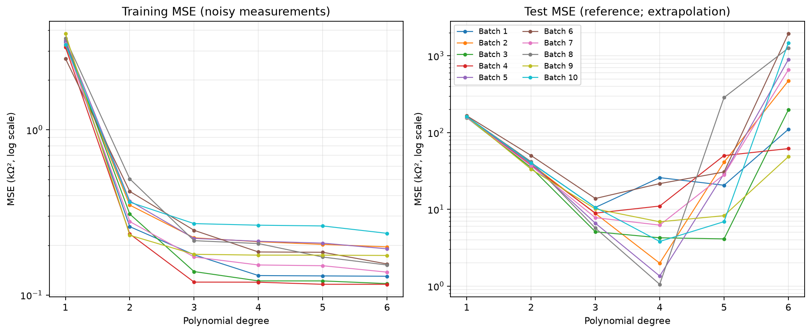
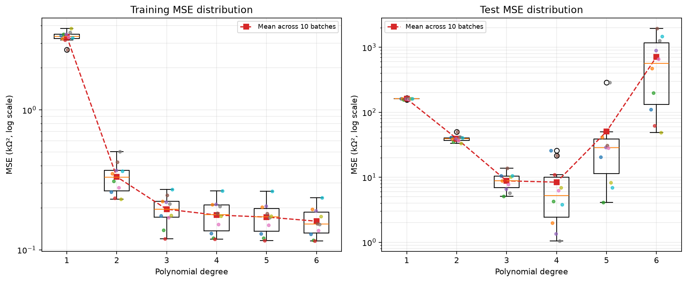
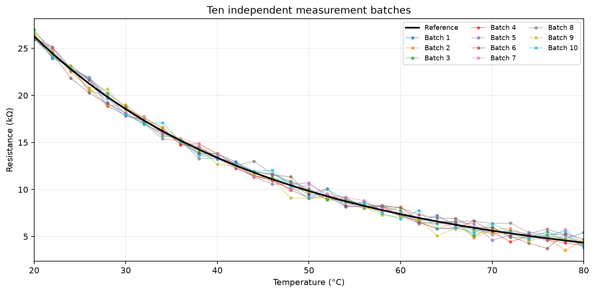
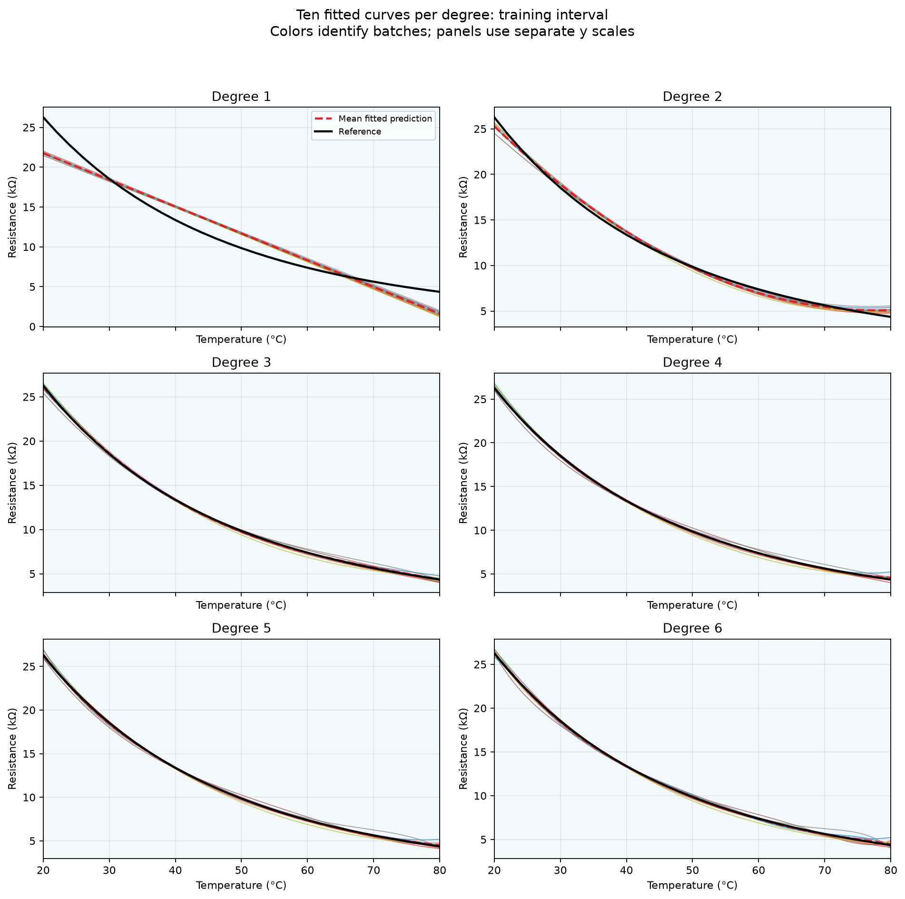
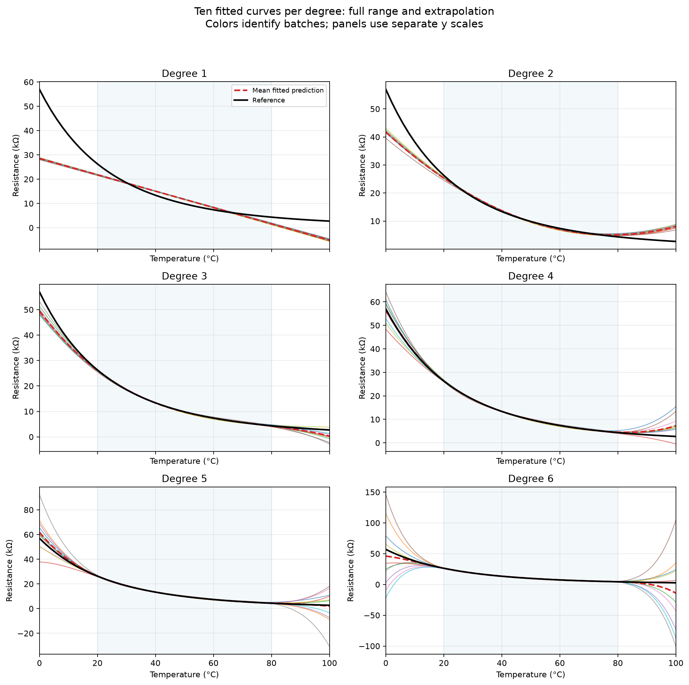

# 十批训练数据对热敏电阻多项式学习结果的影响

## 实验设计与复现

在项目根目录运行 `python3 assign3/repeated_polynomial_fit.py`。依赖 NumPy 和 Matplotlib，脚本也可从其他目录运行。
本实验重复第 2 项 **10 次**，每次都重新生成噪声，再独立拟合 1～6 阶多项式，共获得 **60 个模型**。
输入为 `assign1/thermistor_data.csv`，温度步长保持 2°C。
训练范围为 20～80°C（包含两端，共 31 点），测试范围为 0～18°C 和 82～100°C（共 20 点）。
参考值在全部批次中固定，拟合只用带噪训练数据，不利用物理模型公式。

每批噪声独立生成自 N(0, 0.5²)，单位为 kΩ，即标准差 500Ω。
随机种子依次为 42～51，保证可复现；第 1 批与 assign2 相同，其余 9 批使用新噪声。
每批内部的六种模型共用同一组测量数据，不同批次分别训练，未将 10 批数据合并。
温度采样位置保持不变，因此本实验只考查测量噪声造成的训练数据变化。
零均值指生成分布的期望，实际 31 个噪声样本的均值不必恰好为零；各批噪声统计见 `noise_statistics.csv`。

使用 `numpy.polyfit` 做最小二乘拟合，用 `numpy.polyval` 预测。
MSE = (1/N) Σ(预测阻值 − 对照阻值)²，单位为 kΩ²。
训练 MSE 对照本批带噪测量值；测试 MSE 对照固定的无噪声参考值。
另计算训练区间相对于参考值的 MSE，用来观察对真实曲线的逼近。
所有误差都在原始 2°C 网格上计算，图中加密曲线仅用于显示。

## 十次实验的统计结果

下表的“±”表示十批结果的**样本标准差（ddof=1）**，不是置信区间；所有误差单位为 kΩ²。
完整统计（均值、标准差、中位数、最小值、最大值）见 `error_summary.csv`。

| 阶次 | 训练 MSE 均值 ± 标准差 | 测试 MSE 均值 ± 标准差 | 测试 MSE 中位数 | 训练范围参考 MSE 均值 |
|---:|---:|---:|---:|---:|
| 1 | 3.342510 ± 0.293624 | 160.841736 ± 2.584028 | 161.121144 | 3.099019 |
| 2 | 0.332485 ± 0.088080 | 39.344318 ± 4.622100 | 39.099186 | 0.171612 |
| 3 | 0.195183 ± 0.047419 | 8.799721 ± 2.642229 | 8.865541 | 0.041551 |
| 4 | 0.177156 ± 0.046947 | 8.403070 ± 8.668150 | 5.238658 | 0.044401 |
| 5 | 0.171440 ± 0.044842 | 50.487996 ± 84.019368 | 28.680060 | 0.049469 |
| 6 | 0.160207 ± 0.038646 | 711.641069 ± 665.041355 | 563.662924 | 0.060796 |

每批测试 MSE 最小的阶次如下，属于实验后的描述性比较，不是独立验证的模型选择：

| 批次 | 随机种子 | 测试 MSE 最小的阶次 | 最小测试 MSE（kΩ²） |
|---:|---:|---:|---:|
| 1 | 42 | 3 | 10.572859 |
| 2 | 43 | 4 | 1.985228 |
| 3 | 44 | 5 | 4.117803 |
| 4 | 45 | 3 | 8.904814 |
| 5 | 46 | 4 | 1.350032 |
| 6 | 47 | 3 | 13.829405 |
| 7 | 48 | 4 | 6.224631 |
| 8 | 49 | 4 | 1.052991 |
| 9 | 50 | 4 | 6.874174 |
| 10 | 51 | 4 | 3.807501 |

出现次数为：**3 阶 3 次、4 阶 6 次、5 阶 1 次**。按十批测试 MSE 的平均值比较，最小的是 **4 阶**，均值为 **8.403070 kΩ²**。

具体而言，3 阶的测试 MSE 为 8.799721 ± 2.642229 kΩ²，
4 阶为 8.403070 ± 8.668150 kΩ²。
4 阶平均误差略低，但波动明显更大；这十批结果支持“3 阶较稳定、4 阶平均误差略低”的描述，不能据此断言二者差异具有统计显著性。
5 阶和 6 阶的平均测试误差分别为 50.487996 和 711.641069 kΩ²，且波动很大。

## 对学习结果的影响

**同一阶次的结果取决于训练数据。** 噪声改变每个测量点的位置，最小二乘得到的系数随之改变，预测曲线和 MSE 也发生变化。
`model_coefficients.csv` 给出 60 组系数，`model_equations.md` 列出对应表达式；`coefficient_summary.csv` 给出每个系数跨批次的均值和样本标准差。
不同幂次系数的单位和量级不同（a_j 单位为 kΩ/(°C)^j），不能直接比较它们的绝对标准差来判断模型稳定性，曲线及预测误差更直观。

**训练误差降低不代表外推更可靠。** 每批训练 MSE 都随阶次增加而不升高，因为高阶多项式包含低阶模型的候选解。
但不同批次的测试误差曲线不同，同一批内也可能出现先降后升或其他非单调变化。
1 阶模型表达能力有限，曲线偏差明显；高阶模型虽然更灵活，却对噪声更敏感，尤其在训练区间之外，高次项会放大预测差异。
对比训练区间图和全范围图，可以看到区间内曲线相近并不意味着区间外预测一致。

**一次实验不能确定普遍最优阶次。** assign2 中第 1 批的测试 MSE 最小者为 3 阶，本实验中各批最小者的分布为 3 阶 3 次、4 阶 6 次、5 阶 1 次。
应结合平均误差和波动程度讨论模型；较低的单次误差可能只是该批噪声的结果。
测试误差均值还可能被少量较大的外推误差影响，因此同时报告中位数和全部批次结果。

## 参考误差的经验偏差与方差分解

为量化训练噪声影响，在每个固定温度点计算十个模型预测的平均值与跨批方差：
平均参考 MSE = 平均预测相对于参考曲线的平方偏差 + 预测的跨批方差。
此处方差使用 **ddof=0**，使有限十批的分解精确成立；它不同于上表统计误差时使用的样本标准差。
以下在测试集 20 个温度点上取平均，单位均为 kΩ²：

| 阶次 | 经验平方偏差 | 经验预测方差 | 二者之和（平均测试 MSE） |
|---:|---:|---:|---:|
| 1 | 160.772374 | 0.069362 | 160.841736 |
| 2 | 39.062055 | 0.282263 | 39.344318 |
| 3 | 7.733642 | 1.066079 | 8.799721 |
| 4 | 2.870569 | 5.532501 | 8.403070 |
| 5 | 3.305136 | 47.182860 | 50.487996 |
| 6 | 39.504516 | 672.136552 | 711.641069 |

该分解针对无噪声参考值，不另加测试测量噪声项。
低阶模型的系统性曲线偏差和高阶模型的训练噪声敏感性可分别通过这两项观察。
在本次结果中，1 阶测试误差主要来自平方偏差；6 阶的经验预测方差为 672.136552 kΩ²，
占其平均测试 MSE 的 94.45%，说明更换训练噪声导致的预测波动是其误差的主要来源。
这只是十批实现的经验统计，不能当作无限次实验的精确期望。
`prediction_spread.csv` 还列出各阶次在每个温度点的预测均值和样本标准差。

测试点全在训练范围外，误差反映外推能力，也受到多项式近似的局限影响，不能把全部误差归因于过拟合。
如实际选择模型，应在训练数据内另设验证机制，并保留独立测试集作最终评估。
本实验只有十批，结论适用于当前噪声水平、训练范围与数据采样；固定种子用于复现，不消除学习结果的随机性。

## 输出文件

- `simulated_data.csv`：310 行，十批模拟测量。
- `noise_statistics.csv`：每批噪声样本均值和标准差。
- `model_coefficients.csv`、`model_equations.md`：60 个模型的系数和表达式，CSV 系数按 a6～a0 排列，超出阶次的项填零。
- `model_errors.csv`：60 行，逐批逐阶次的三种 MSE。
- `model_predictions.csv`：3060 行，每批每阶次在 51 个原始温度上的预测。
- `error_summary.csv`、`best_degree_by_batch.csv`：误差汇总和每批测试误差最小者。
- `coefficient_summary.csv`、`prediction_spread.csv`：系数及预测随批次变化的统计。
- `empirical_bias_variance.csv`：训练范围与测试范围的经验偏差、方差分解。
- 五组图表均提供 PNG 与 SVG。
