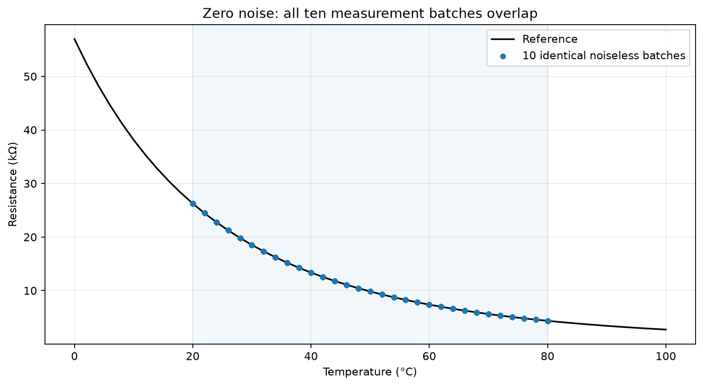
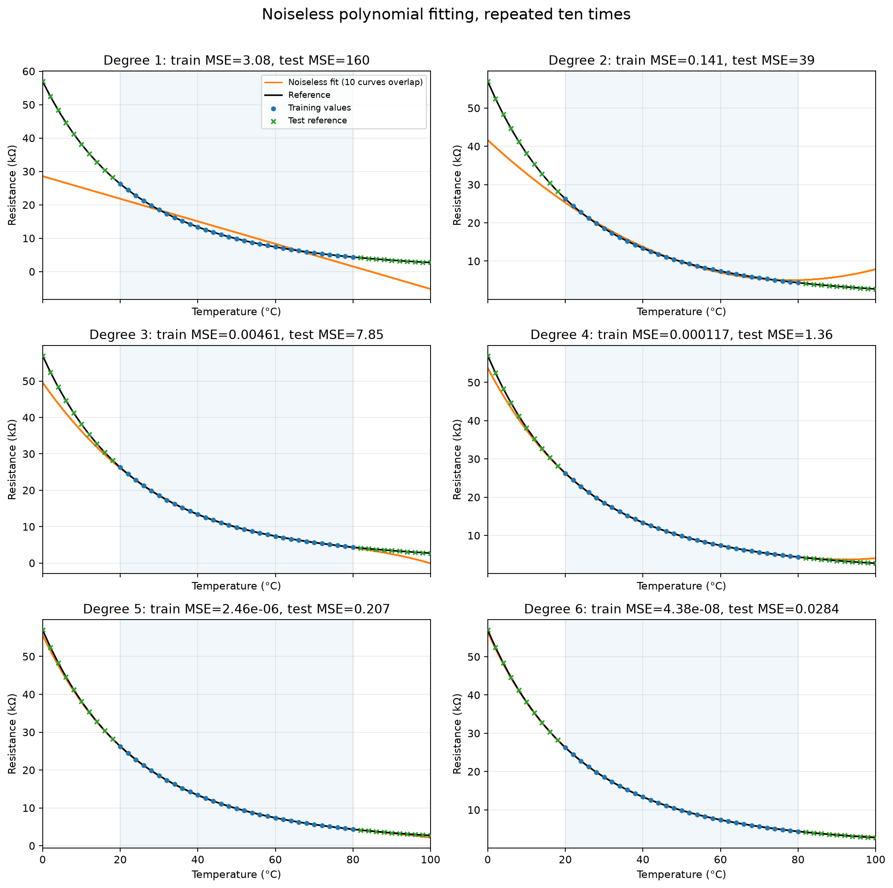
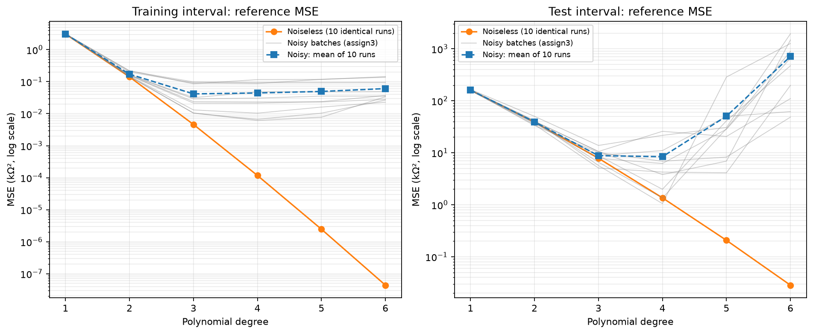
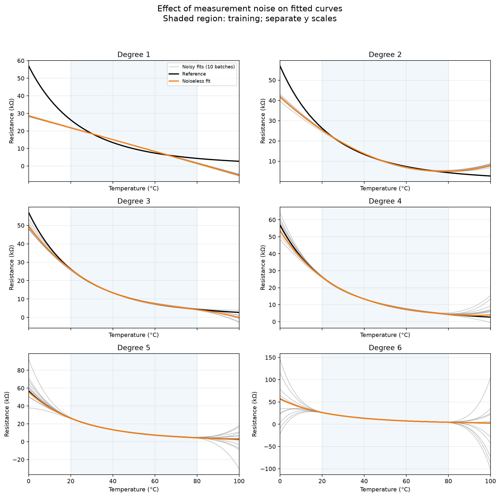

# 零噪声条件下的多项式拟合及重复实验

## 实验方法

在项目根目录运行 `python3 assign4/noiseless_polynomial_fit.py`，依赖 NumPy 和 Matplotlib。
脚本使用 assign1 的参考数据，并读取 assign3 的十批带噪模型作比较；必要时先运行 `python3 assign3/repeated_polynomial_fit.py`。

保持第 2、3 项的条件：步长 2°C，训练温度 20～80°C（含端点，共 31 点），
测试温度 0～18°C 和 82～100°C（共 20 点），用最小二乘拟合 1～6 阶多项式。
区别是将测量噪声方差设为 **0**，即 ε=0，模拟测量值直接等于参考阻值。
每个阶次仍重新拟合十次，共执行 60 次拟合，未将十批数据合并。
无噪声时，训练温度和测量值均不变；十次数据完全相同，并非十批不同的随机样本。

MSE = (1/N) Σ(预测阻值 − 参考阻值)²，单位为 kΩ²。
零噪声时训练测量值等于参考值，因此训练残差 MSE 和训练范围参考 MSE 相同。
原始 CSV 阻值保留六位小数，这种输入舍入仍然存在；“零噪声”指不再添加随机测量噪声。
图中加密点仅用于显示，误差均使用原始 2°C 采样网格。

## 模型与误差

t 使用 °C，阻值使用 kΩ；a_j 的单位为 kΩ/(°C)^j。十次得到的同阶模型完全相同，下列仅列一次。
系数显示 12 位有效数字，CSV 保存完整浮点精度。

- **1 阶**：\(\hat R_1(t)=-0.337607653831t + 28.5671014012\)

- **2 阶**：\(\hat R_2(t)=0.00599613352115t^2 - 0.937221005945t + 41.6386724773\)

- **3 阶**：\(\hat R_3(t)=-8.26784581836\times 10^{-5}t^3 + 0.0183979022487t^2 - 1.50975279318t + 49.5956472929\)

- **4 阶**：\(\hat R_4(t)=9.67528560589\times 10^{-7}t^4 - 0.000276184170301t^3 + 0.0321174572378t^2 - 1.9141797315t + 53.7350595647\)

- **5 阶**：\(\hat R_5(t)=-1.00613049081\times 10^{-8}t^5 + 3.4828547876\times 10^{-6}t^4 - 0.0005170518098t^3 + 0.0430943408925t^2 - 2.15078524126t + 55.6549497182\)

- **6 阶**：\(\hat R_6(t)=9.55786008675\times 10^{-11}t^6 - 3.87348851683\times 10^{-8}t^5 + 6.94314769756\times 10^{-6}t^4 - 0.000731217387453t^3 + 0.0502354719358t^2 - 2.27196346166t + 56.4702081297\)

| 阶次 | 训练 MSE（十次相同） | 测试 MSE（十次相同） | 训练 MSE 跨批标准差 | 测试 MSE 跨批标准差 |
|---:|---:|---:|---:|---:|
| 1 | 3.077380244 | 160.1066528 | 0 | 0 |
| 2 | 0.1412640485 | 38.96433926 | 0 | 0 |
| 3 | 0.004608647778 | 7.854010139 | 0 | 0 |
| 4 | 0.0001172564996 | 1.359256101 | 0 | 0 |
| 5 | 2.456314701e-06 | 0.207251887 | 0 | 0 |
| 6 | 4.383593237e-08 | 0.02841199102 | 0 | 0 |

同一阶次的系数、预测和误差在十次实验中完全一致，跨批极差和标准差均为零。
脚本检查十组预测逐元素相等；汇总直接取共同值和零标准差，避免计算十个相同浮点数的均值时引入无意义的舍入波动。
本次 1～6 阶范围内，测试 MSE 最小的是 **6 阶**，值为 **0.02841199102 kΩ²**，十次均如此。

## 与第 3 项带噪实验比较

为使比较使用相同对照值，下表两种条件的训练范围误差均对照无噪声参考值。
带噪实验的训练残差（对照带噪测量）也保存在 `noise_comparison.csv`，但它与下表的训练参考误差含义不同。
带噪测试列给出十批均值 ± 样本标准差（ddof=1）；所有 MSE 单位为 kΩ²。

| 阶次 | 无噪声训练参考 MSE | 带噪训练参考 MSE 均值 | 无噪声测试 MSE | 带噪测试 MSE 均值 ± 标准差 | 带噪/无噪声平均测试误差比 |
|---:|---:|---:|---:|---:|---:|
| 1 | 3.077380244 | 3.09901894 | 160.10665278 | 160.84173631 ± 2.58402756 | 1.00 |
| 2 | 0.1412640485 | 0.17161207 | 38.96433926 | 39.34431784 ± 4.62209983 | 1.01 |
| 3 | 0.004608647778 | 0.04155093 | 7.85401014 | 8.79972102 ± 2.64222895 | 1.12 |
| 4 | 0.0001172564996 | 0.04440146 | 1.35925610 | 8.40307038 ± 8.66815038 | 6.18 |
| 5 | 2.456314701e-06 | 0.04946888 | 0.20725189 | 50.48799591 ± 84.01936837 | 243.61 |
| 6 | 4.383593237e-08 | 0.06079646 | 0.02841199 | 711.64106883 ± 665.04135461 | 25047.21 |

## 观察与讨论

**去除噪声消除了本实验的批次差异。** 第 3 项中不同测量噪声会改变最小二乘系数，训练区间外的预测尤为敏感。
本项温度、阻值和算法全部固定，因此重复训练得到同一组系数和曲线，没有随机训练数据引起的波动。
重复十次只验证可重复性，不增加独立信息，也不会通过重复操作进一步改善模型。

**本次无噪声数据支持更高阶的逼近。** 随阶次从 1 增至 6，训练 MSE 和测试 MSE 均连续下降。
1 阶模型仍有明显欠拟合；增加阶次改善了对真实曲线弯曲形状的表达。
第 3 项中平均测试 MSE 最小者为 4 阶，而本项为 6 阶：
带噪时提高阶次可能放大测量扰动，无噪声时这项不稳定性消失，当前范围内提高阶次带来的近似改善占主导。

**噪声对高阶外推的影响更明显。** 6 阶无噪声测试 MSE 为 0.02841199 kΩ²，
第 3 项带噪的平均测试 MSE 为 711.64106883 kΩ²，后者约为前者的 25047.21 倍。
曲线图显示带噪高阶模型在训练区间内较接近，却在低温端和高温端明显分散；无噪声高阶曲线的外推更接近参考值。
这说明较小的测量噪声也可能通过高次项在外推区间被显著放大。

**零噪声仍不意味着零误差。** 用有限阶多项式近似原来的指数特性曲线，存在模型近似误差；
最小二乘仅优化训练区间，不直接优化区间外预测，因此所有阶次的测试误差仍为正。
本次在 1～6 阶内测试误差下降是实际观察结果，不是“无噪声时任意提高阶次必然改善外推”的普遍定理。
更高阶、更远外推或不同采样条件下仍可能出现数值问题或近似偏差。

本比较揭示了模型表达能力与训练数据噪声的共同作用：低阶模型偏差较大，高阶模型更灵活但更容易放大噪声。
减少测量噪声有助于稳定学习结果，使本例中的高阶拟合更准确；模型评估仍需区分训练拟合与区间外预测。

## 输出文件

- `simulated_data.csv`：十批共 310 个训练点，noise_kOhm 列全为零。
- `model_coefficients.csv`：60 行模型系数，按 a6～a0 排列，超出阶次的项填零。
- `model_predictions.csv`：60 个模型在 51 个温度点上的 3060 行预测。
- `model_errors.csv`、`error_summary.csv`：逐批误差及零波动汇总。
- `best_degree_by_batch.csv`：每批测试 MSE 最小者。
- `noise_comparison.csv`：与 assign3 的逐阶次对照统计。
- 四组图表均提供 PNG 和 SVG。
