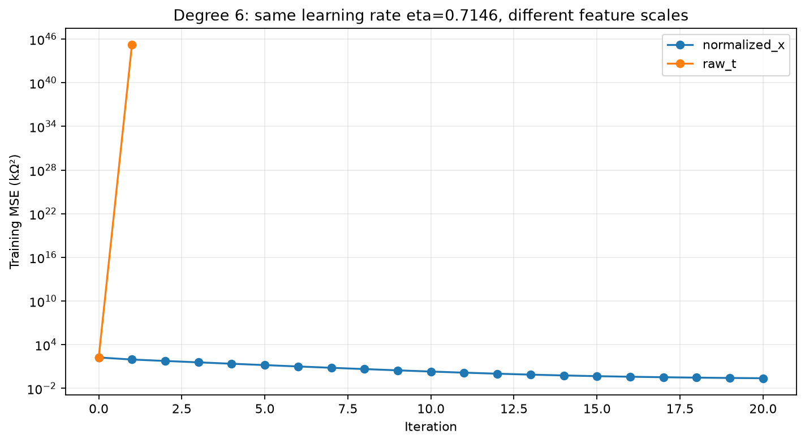
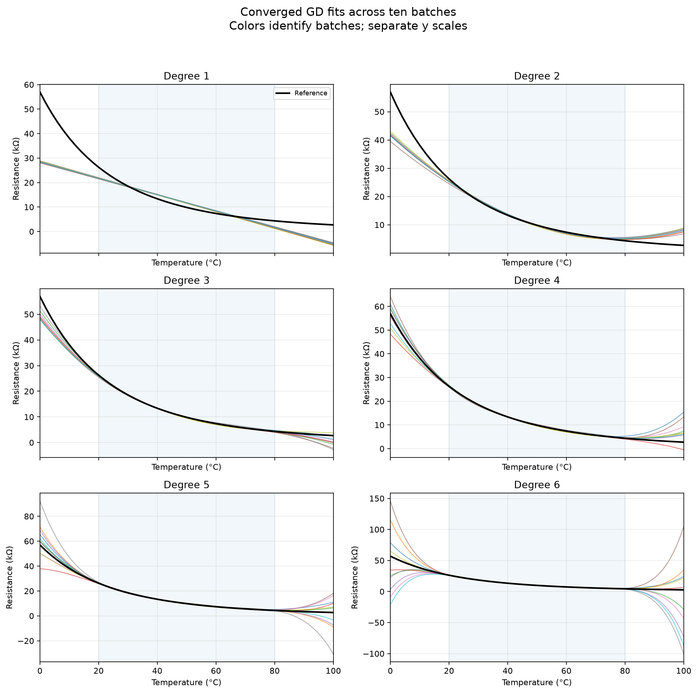
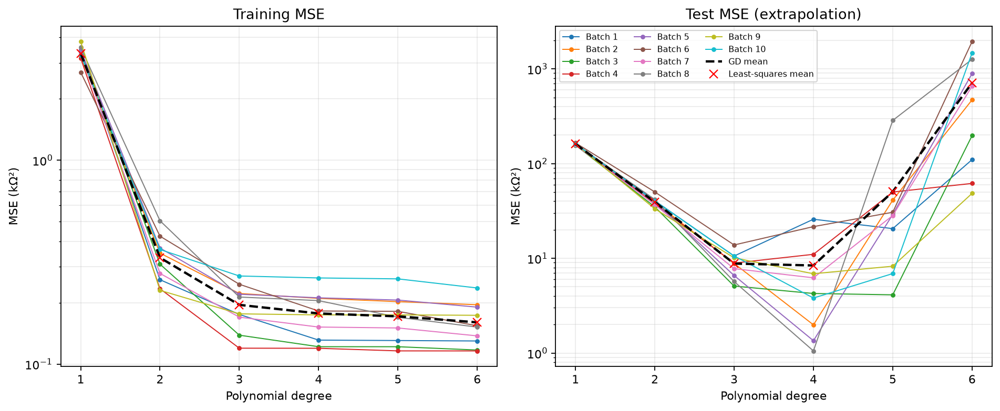
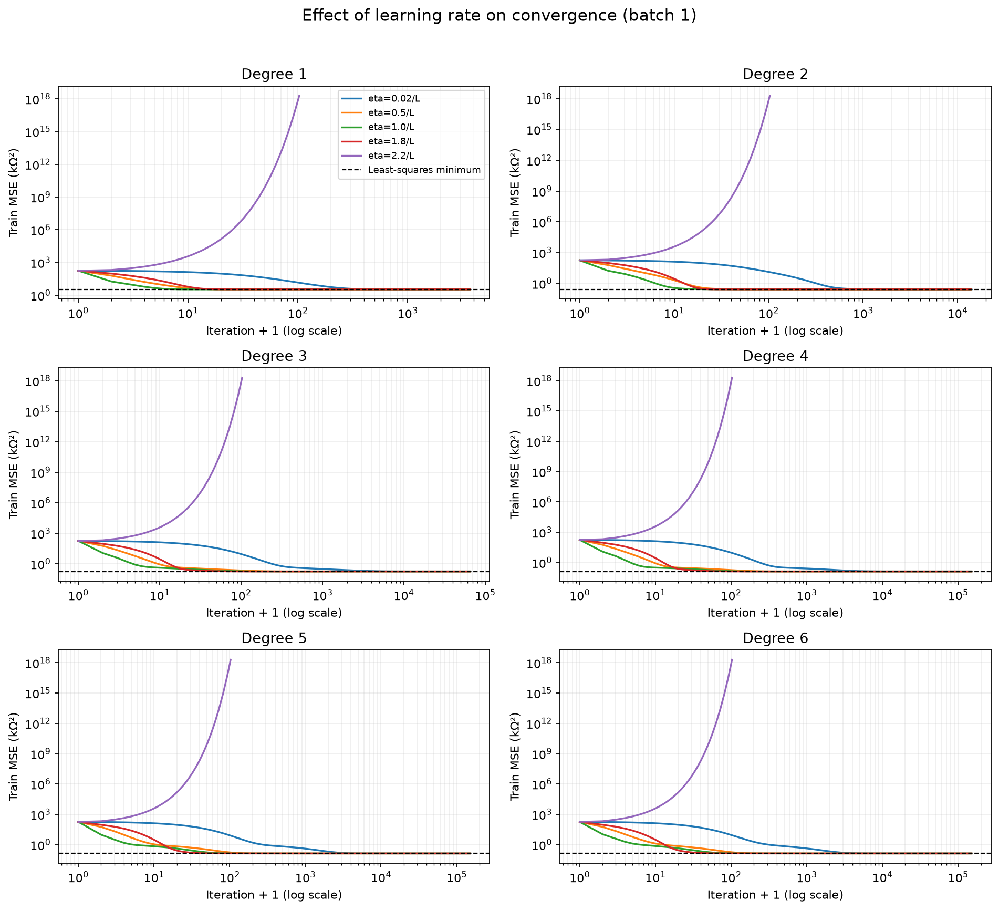
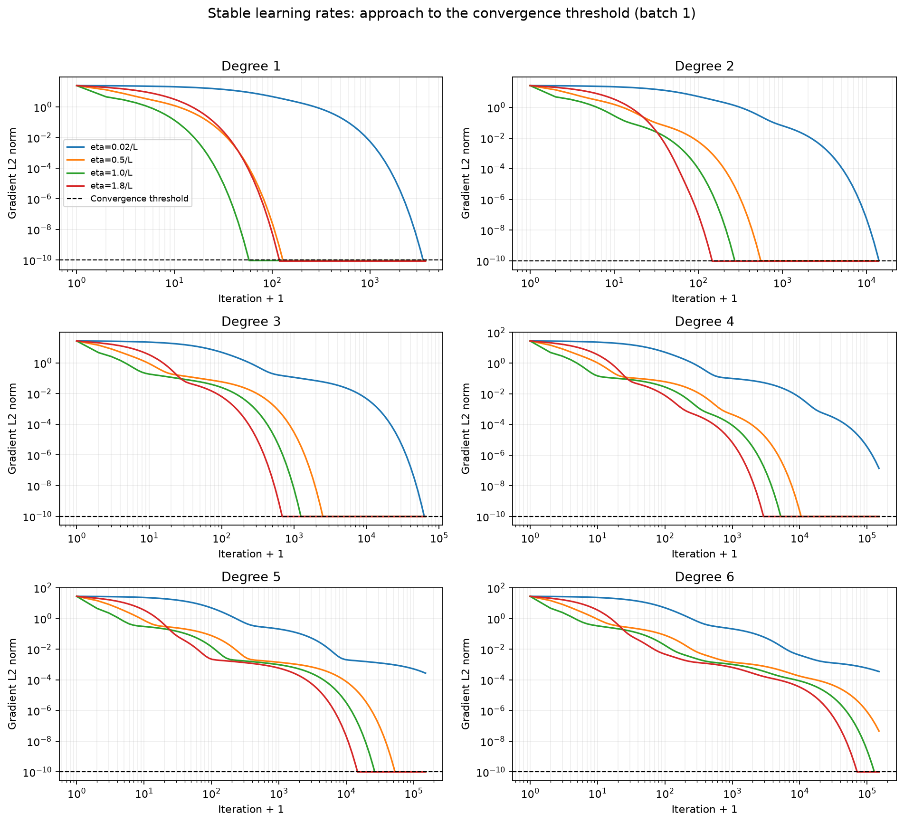
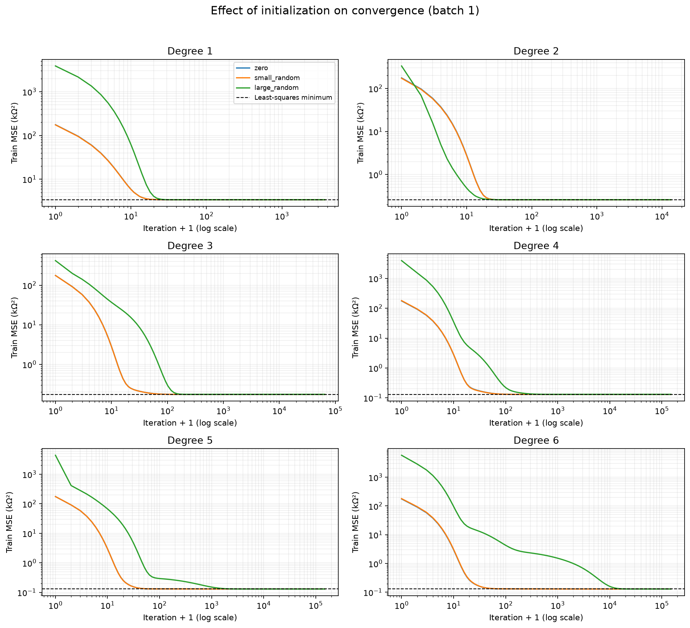
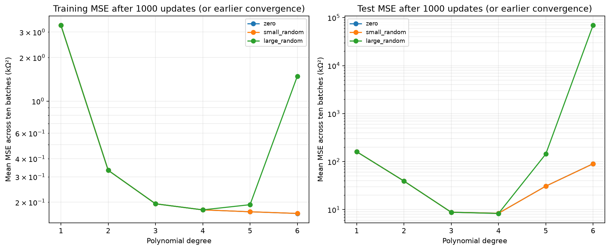

# 梯度下降拟合热敏电阻：初值与学习率的影响

## 运行与实验设置

在项目根目录执行 `python3 assign5/gradient_descent_fit.py`，依赖 NumPy 和 Matplotlib。
需要 assign1 的参考数据和 assign3 的十批模拟测量；若缺少输入，先运行相应脚本。
完成计算后运行 `python3 assign5/verify_results.py` 可核验有限差分梯度、梯度下降更新、900 个配置的独立二次迭代轨迹、系数转换及误差。
完整实验包含 **900 次梯度下降运行**：10 批 × 6 种阶次 × 3 种初值 × 5 档学习率。
其中零初值、η=1.8/L 的 60 次运行作为重复第 2、3 项的基准结果。

训练范围为 20～80°C（含端点，2°C 步长，共 31 点），测试范围为 0～18°C 和 82～100°C（共 20 点）。
沿用 assign3 的十批数据，每批独立噪声 ε~N(0,0.5²) kΩ，测量随机种子为 42～51；输入也复制到本目录。
每批各算法设置使用完全相同的数据，未重新抽取噪声或合并批次。
训练 MSE 对照带噪测量，测试 MSE 对照无噪声参考；单位均为 kΩ²。

## 梯度下降算法

用 x=(t−50)/30 将训练温度缩放到 [−1,1]，构造 X=[1,x,…,xⁿ]，模型为 R̂=Σ b_j xʲ。
损失 J(θ)=(1/N)||Xθ−y||²，解析梯度为 ∇J=(2/N)Xᵀ(Xθ−y)。
每步执行 θ←θ−η∇J，采用全部 31 个训练点的批量梯度下降。
代码缓存 H=(2/N)XᵀX 和 q=(2/N)Xᵀy，更新等价地写为 θ←θ−η(Hθ−q)。
同时计算多个配置只是将独立运行按数组并列，各运行使用自身参数、数据、学习率与停止状态。

温度缩放没有改变多项式模型空间，也没有使用正则化。
CSV 同时保存 x 基底的 b0～b6 和转换回摄氏温度 t 基底的 a6～a0。
由于 x 无量纲，b_j 的单位均为 kΩ；a_j 的单位为 kΩ/(°C)^j。
预测优先在 x 基底计算，以减少数值消减；超出实际阶次的系数填零。
最小二乘 `lstsq` 只用来提供验证基准，不用于梯度更新或初始化。

停止规则：梯度二范数 ≤ 1e-10 则标记 converged；最多 150000 次更新。
超过上限仍未收敛标记 max_iterations，不能当作最优解。
参数出现非有限值或任一绝对值超过 10¹⁰，标记 diverged，其最终 MSE 记为 NaN 并排除出均值。
另记录统一 1000 次更新预算的结果；提前收敛者保留收敛值，提前发散者不提供有效预算误差。
历史曲线按预定对数间隔及收敛时刻采样，不保存每一步。

## 参数初值与学习率设计

初值分别为全零、N(0,0.1²) 的小幅随机值、N(0,50²) 的大幅随机值。
初始化随机种子为 20261010+阶次，各阶次在不同批次和学习率下共用各自相同的初值向量。
这样可分别观察训练数据、初值和学习率的作用。

H 正定，令 L 为最大特征值，μ 为最小特征值；固定步长的充分稳定条件为 0<η<2/L。
设置 η=c/L，c∈{0.02,0.5,1.0,1.8,2.2}，分别覆盖很小步长、稳定步长与超过稳定界限的情况。
c=1.8 的稳定更新可能沿部分特征方向交替靠近解；它仍处于稳定范围内。
η=2.2/L 会放大最大特征值方向的误差，本次数据及初值中出现发散。

随着阶次增加，H 的条件数从 2.81 增至 8635.46。
不同方向收敛速度因此差异很大，即使已缩放温度，6 阶的最慢方向仍需较多迭代。
原始 t 基底的 6 阶稳定学习率上界约为 1.25e-22，
缩放基底则约为 0.794052。示例使用同一个缩放后适用的学习率，原始特征迅速发散。
这说明学习率必须与特征尺度匹配，不意味着原始特征使用任意学习率都会发散。

## 十批基准拟合结果

零初值、η=1.8/L。下表 ± 为十批 MSE 的样本标准差（ddof=1），不是置信区间。
GD–LS 差异是同批同阶两种算法在原始 51 个温度点预测的最大绝对差。

| 阶次 | 训练 MSE 均值 ± 标准差 | 测试 MSE 均值 ± 标准差 | 平均迭代次数 | 最大迭代次数 | 最大 GD–LS 预测差（kΩ） |
|---:|---:|---:|---:|---:|---:|
| 1 | 3.342510 ± 0.293624 | 160.841736 ± 2.584028 | 118.0 | 118 | 4.35e-11 |
| 2 | 0.332485 ± 0.088080 | 39.344318 ± 4.622100 | 144.5 | 147 | 1.22e-09 |
| 3 | 0.195183 ± 0.047419 | 8.799721 ± 2.642229 | 678.8 | 689 | 7.57e-09 |
| 4 | 0.177156 ± 0.046947 | 8.403070 ± 8.668150 | 3169.6 | 3319 | 4.81e-08 |
| 5 | 0.171440 ± 0.044842 | 50.487995 ± 84.019367 | 14813.9 | 16051 | 3.15e-07 |
| 6 | 0.160207 ± 0.038646 | 711.641028 ± 665.041328 | 79433.5 | 83576 | 2.11e-06 |

按平均测试 MSE 比较，最小的是 **4 阶**。十批测试 MSE 最小者依次为 [3, 4, 5, 3, 4, 3, 4, 4, 4, 4]。
充分收敛的梯度下降重现最小二乘拟合的训练与外推规律：提高阶次降低训练残差，却不能保证区间外误差下降。
改变求解算法不会消除第 3 项中的测量噪声敏感性。

## 学习率实验

以下每格为 **收敛 / 达到迭代上限 / 发散** 的运行数，每格共 30 次（10 批 × 3 初值）。
全部逐次结果见 `sensitivity_results.csv`，逐配置十批统计见 `sensitivity_summary.csv`。

| 阶次 | 0.02/L | 0.5/L | 1.0/L | 1.8/L | 2.2/L |
|---:|---:|---:|---:|---:|---:|
| 1 | 30/0/0 | 30/0/0 | 30/0/0 | 30/0/0 | 0/0/30 |
| 2 | 30/0/0 | 30/0/0 | 30/0/0 | 30/0/0 | 0/0/30 |
| 3 | 30/0/0 | 30/0/0 | 30/0/0 | 30/0/0 | 0/0/30 |
| 4 | 0/30/0 | 30/0/0 | 30/0/0 | 30/0/0 | 0/0/30 |
| 5 | 0/30/0 | 30/0/0 | 30/0/0 | 30/0/0 | 0/0/30 |
| 6 | 0/30/0 | 0/30/0 | 18/12/0 | 30/0/0 | 0/0/30 |

很小学习率的更新稳定但缓慢，在相同迭代预算内可能尚未充分接近最小二乘解。
具体地，η=0.02/L 时 4～6 阶的全部运行达到迭代上限；6 阶在 η=0.5/L 下也全部未满足收敛判据，
η=1/L 时有 18 次收敛、12 次达到上限，η=1.8/L 时 30 次全部收敛。
适当增加学习率能减少迭代次数；超过稳定上界则发散，不能靠延长迭代修复。
不同阶次的 L 不同，本实验使用 ηL 的相对尺度比较；实际 η 也保存在 CSV。

## 初值实验

损失为严格凸二次函数，且本次 X 满列秩，因此最优解唯一。
在稳定学习率和充分迭代下，三种初值都应趋近同一最小二乘解，不存在因初值而落入不同局部最小值的问题。
但初始误差在不同特征方向的分量不同，导致收敛速度和有限预算下的参数、预测不同。
大幅初值通常使初始损失更大；收敛耗时不能只凭初值大小判断，还取决于其在慢方向上的分量。

下表展示 6 阶、η=1.8/L 的十批结果：

| 初值 | 收敛次数 | 收敛运行平均迭代次数 | 1000 步预算训练 MSE 均值 | 1000 步预算测试 MSE 均值 |
|---|---:|---:|---:|---:|
| zero | 10 | 79433.5 | 0.167356 | 90.229031 |
| small_random | 10 | 79378.5 | 0.167412 | 89.972029 |
| large_random | 10 | 94063.1 | 1.486972 | 69230.959777 |

最终收敛结果和 1000 步结果应分别解读：前者验证求解到同一最优解，后者显示初值带来的优化进度差异。
本次 6 阶大幅随机初值平均约需 94063 步，而零初值约需 79434 步；在 1000 步时，大幅初值的平均测试误差仍很大。
零初值 6 阶在 1000 步的平均测试 MSE 约为 90.23，充分收敛后约为 711.64，
说明继续降低训练损失也可能使外推误差增大；不能通过观察测试集来随意选择提前停止时刻。
测试误差的变化还包含测量噪声及外推效应，不一定随训练优化进度改善而下降。

## 结论与限制

模型初值、学习率和训练噪声分别作用于优化起点、更新稳定性、所学习的目标数据。
稳定步长并充分收敛时，初值不改变唯一最优解；迭代不足则保留初值和步长影响。
训练噪声仍会改变最优解，高阶模型在训练范围外的预测更易波动。
必须区分“梯度下降尚未收敛”和“已收敛模型的外推误差较大”，不能将它们都称为过拟合。
本实验将测试误差用于描述性比较，实际选阶次或优化设置应另用验证数据，保留独立测试集。

## 文件说明

- `simulated_data.csv`：与 assign3 相同的 310 个带噪训练点。
- `model_coefficients.csv`：60 个基准模型的 x 与 t 基底系数。
- `model_equations.md`：对应的 60 个摄氏温度多项式表达式。
- `model_predictions.csv`：3060 行 GD、LS 预测及参考值。
- `model_errors.csv`、`error_summary.csv`：基准逐批误差与十批统计。
- `sensitivity_results.csv`：900 次运行的状态、迭代次数、误差、最优损失差和 1000 步结果。
- `sensitivity_summary.csv`：每阶次、初值、学习率的十批统计；有效误差均值排除发散者，但包含未收敛者，须结合状态列阅读。
- `loss_history.csv`：采样损失与梯度范数。
- `feature_geometry.csv`：H 特征值、条件数及稳定步长上界。
- `feature_scale_demo.csv`：原始与缩放特征的同学习率示例。
- `verify_results.py`：独立数值核验，不重新执行完整参数扫描。
- 七组图表各提供 PNG 与 SVG；收敛后保留参数值，历史曲线延长部分表示该值保持不变，并非继续更新。
